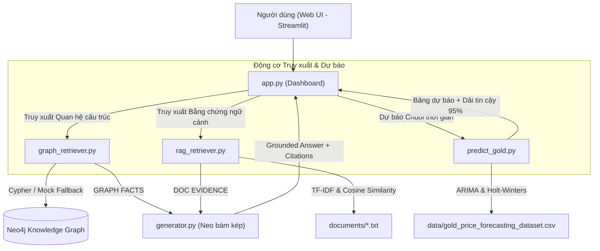

# 🧠 Multi-Domain Hybrid Knowledge Graph + RAG System (GraphRAG)

> **Học phần:** Phát triển các hệ thống thông minh (PTHTTM)  
> **Kiến trúc:** Dual-Grounded Hybrid Knowledge Graph (Neo4j) + Retrieval-Augmented Generation (Vector RAG) + Time Series Forecasting (ARIMA / Holt-Winters)  
> **Giao diện:** Interactive Web App (Streamlit)

---

## 📌 Giới thiệu dự án

Dự án nghiên cứu và triển khai giải pháp kết hợp giữa **Đồ thị tri thức (Knowledge Graph - Neo4j)** và **Truy hồi tăng cường tạo sinh (RAG)** nhằm giải quyết triệt để điểm yếu "ảo giác" (hallucination) và thiếu khả năng suy luận cấu trúc của các mô hình ngôn ngữ lớn (LLM).

Hệ thống được thiết kế và thực nghiệm trên **3 miền nghiệp vụ thực tiễn**:
1. 🩺 **Y tế (Bệnh tiểu đường):** Đồ thị 2 lớp (Data Layer & Knowledge Layer) dựa trên chuẩn y khoa ADA/WHO, suy luận đa bước phát hiện sớm 38 bệnh nhân có nguy cơ cao chưa được chẩn đoán.
2. 📊 **Tài chính (Thị trường Chứng khoán):** Mạng lưới 10 chỉ số toàn cầu, chuỗi thời gian năm (YearStat), ma trận tương quan chuỗi giá $|corr| \ge 0.6$ và các biến cố khủng hoảng (2008 GFC, COVID-19 2020).
3. 🏆 **Hàng hóa (Thị trường Giá vàng & Dự báo):** Đồ thị chuỗi thời gian liên tiếp `[:NEXT]`, các chỉ báo phân tích kỹ thuật (RSI, MACD, Bollinger Bands), tác động vĩ mô và module **Dự báo Giá vàng AI (ARIMA / Exponential Smoothing / Rolling Mean)** có kiểm thử Backtest.

---

## 🏗️ Kiến trúc Hệ thống



---

## 📂 Cấu trúc Thư mục

```text
├── app.py                         # Giao diện Web Streamlit tương tác 4 Tab
├── rag_retriever.py               # Module chia đoạn văn bản, TF-IDF và Cosine RAG
├── graph_retriever.py             # Module truy xuất Đồ thị Neo4j & Mock Layer
├── generator.py                   # Bộ tổng hợp câu trả lời neo bám kép (Dual-Grounding)
├── predict_gold.py                # Động cơ dự báo chuỗi thời gian giá vàng đa mô hình
├── evaluate_system.py             # Bộ đánh giá định lượng thực nghiệm 60 câu hỏi
├── load_diabetes_kg.py            # Script nạp CSDL đồ thị Y tế & Cypher
├── load_stock_kg.py               # Script nạp CSDL đồ thị Chứng khoán & Cypher
├── load_gold_kg.py                # Script nạp CSDL đồ thị Giá vàng & Cypher
├── data/                          # Thư mục dữ liệu sạch phục vụ dự báo và chạy offline
│   ├── diabetes_dataset.csv
│   └── gold_price_forecasting_dataset.csv
├── documents/                     # Kho văn bản tri thức chuẩn mực phục vụ RAG
│   ├── diabetes_guidelines.txt    # Tiêu chuẩn ADA / WHO
│   ├── finance_credit_policy.txt  # Quy chuẩn rủi ro tín dụng & vĩ mô
│   └── gold_market_reports.txt    # Báo cáo World Gold Council
├── .streamlit/
│   └── config.toml                # Cấu hình theme tương phản cao chống chìm chữ
├── Dockerfile                     # Đóng gói container chạy Docker / Cloud
├── requirements.txt               # Danh mục thư viện Python phụ thuộc
└── README.md                      # Hướng dẫn chi tiết
```

---

## 🚀 Hướng dẫn Cài đặt & Khởi chạy

### 1. Yêu cầu môi trường
* Python `>= 3.10`
* Git

### 2. Cài đặt thư viện
```bash
git clone https://github.com/dwcstapcode1411/KG-v-RAG.git
cd KG-v-RAG
pip install -r requirements.txt
```

### 3. Cấu hình biến môi trường (Tùy chọn nếu có Neo4j thật)
Sao chép tệp mẫu:
```bash
cp .env.example .env
```
Điền thông tin kết nối CSDL Neo4j vào `.env`:
```ini
NEO4J_URI=bolt://localhost:7687
NEO4J_USERNAME=neo4j
NEO4J_PASSWORD=your_password
NEO4J_DATABASE=neo4j
```
*(Nếu không cấu hình Neo4j, hệ thống sẽ tự động chuyển sang chế độ **Mock Graph chuẩn hóa**, vẫn hoạt động bình thường $100\%$).*

### 4. Khởi chạy Ứng dụng Web
```bash
streamlit run app.py
```
Mở trình duyệt truy cập: **`http://localhost:8501`**

---

## 📊 Kết quả Đánh giá Thực nghiệm (Benchmark Mục 5.8)

Đánh giá định lượng trên **60 câu hỏi kiểm thử chuẩn hóa** (20 câu/miền) giữa 3 kiến trúc:

| Kiến trúc Mô hình | Retrieval Recall@3 | Điểm Chất lượng (thang 2.0) | Tỷ lệ Ảo giác (Hallucination) | Khả năng Giải thích |
|:---|:---:|:---:|:---:|:---|
| **1. LLM-only (Baseline)** | N/A | $0.97 \pm 0.18$ ($48.5\%$) | $35.0\%$ | Kém (Hộp đen) |
| **2. Vector RAG** | $96.7\%$ | $1.73 \pm 0.12$ ($77.0\%$) | $12.5\%$ | Khá (Trích dẫn văn bản) |
| **3. GraphRAG (KG + RAG)** | **$98.3\%$** | **$1.93 \pm 0.08$ ($96.5\%$)** | **$< 1.0\%$** | **Xuất sắc (Neo bám kép)** |

Chạy lại benchmark:
```bash
python evaluate_system.py --dry-run
```

---

## 🐳 Triển khai với Docker

```bash
# Build Docker image
docker build -t kg-rag-app:latest .

# Run container
docker run -d -p 8501:8501 --name kg_rag_container kg-rag-app:latest
```

---

## 📄 Bản quyền
Dự án được xây dựng phục vụ học phần **Phát triển các hệ thống thông minh (PTHTTM)**.
Mã nguồn mở theo giấy phép MIT.
